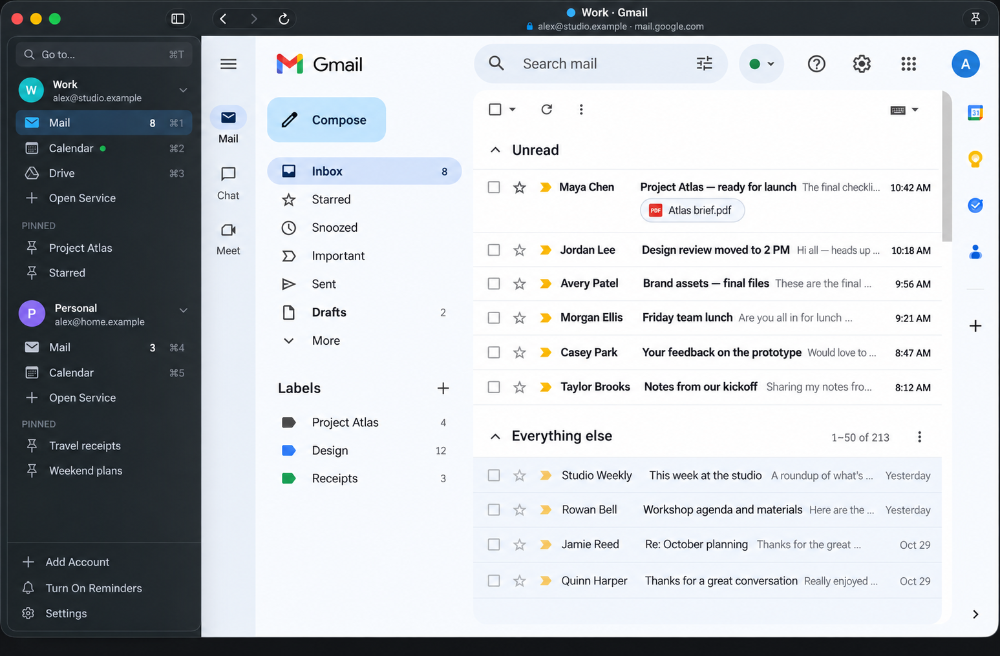

# MailPort

MailPort puts Gmail, Calendar, YouTube, and your other Google services in one Mac window, with every account a click away. Each account keeps its own sign-in, and pages stay loaded as you switch between them.



MailPort is an independent preview, not affiliated with or endorsed by Google. It shows Google's own web pages, and Google may reject its embedded browser or ask for extra verification, so sign-in isn't guaranteed for every account.

> Why did I make this app?

*I used another app called [MailPlane](https://mailplaneapp.com/) for many years but they stopped supporting it long ago and it will stop working on Mac in the near future because it is Intel based app. There were also many features I always wanted that it just did not support. So I finally got tired of seeing the Apple nag that app is going away and that drove me to make the app I actually wanted MailPlane to actually be in the first place.*


## Install

MailPort needs macOS 14 or later on Apple silicon.

1. Download the latest `.dmg` from [Releases](https://github.com/yepher/mail-port/releases/latest).
2. Open it and drag MailPort to Applications.

MailPort then keeps itself up to date. If your copy is version 0.6.1 or earlier, repeat these steps once to get the version that can.

## Using MailPort

### Add an account

1. Select **Add Account** at the bottom of the sidebar.
2. Enter a name such as Work, then choose a color. The email label is optional and only used for display.
3. Sign in on Google's page in the account's Mail view.

The name and color are labels only. The Google account is whichever one you sign in to. Passkeys aren't supported, so use **Try another way** on Google's page if it offers one.

### Move around

- **Switch views:** select a service in the sidebar, or press ⌘1–9. The first nine views show their shortcut.
- **Go To:** press ⌘T and type, such as `personal cal`, to find any account, service, or pinned page.
- **Open a service:** select **Open Service** under an account. Mail, Calendar, Drive, Contacts, Chat, Meet, YouTube, Gemini, Colab, and NotebookLM are available.
- **Check where you are:** the toolbar shows the current account, its email label, and the page's address.

Links to other websites open in your default browser. Unread counts appear beside Mail, and a green dot beside Calendar means a timed event is happening now.

An orange warning and a **Sign In** row mean Google signed the account out. Select **Sign In** and finish on Google's page. Its unread count and Calendar dot then come back.

### Control and pop out YouTube videos

A green play indicator beside YouTube identifies the account currently playing video, including in a pop-out. Hover over it to see the video title. The indicator also appears on collapsed account headers and in tab-bar mode, and clears when playback pauses or ends.

While a video is loaded, right-click (or Control-click) MailPort’s Dock icon to play or pause it without bringing MailPort forward. If several accounts have videos loaded, each gets its own controls.

Select **Pop Out Video** in the YouTube toolbar, Navigate menu, or Dock menu to move the existing player into a small window that stays above ordinary app windows and follows your desktops. Drag it into a corner and resize it as needed. The floating player is borderless until you move the pointer over it. A title bar then fades in with Close, Play/Pause, and Return to Tab controls. Drag the title bar to move it, or drag the lower-right grip to resize it. MailPort remembers the floating window’s position and size across pop-outs and app restarts. It keeps the window on an available screen if monitors change and preserves each video’s aspect ratio. Hovering never changes the video size. The opacity slider adjusts the video from 100% opaque down to 15% visible, with a live preview. Hover controls stay fully readable, and MailPort remembers the level for your next pop-out. Closing the floating window also returns the video to its tab without restarting it. MailPort crops the existing web view natively; it does not extract the stream or restyle YouTube. Start playback first, keep the player fully visible, and exit fullscreen before popping it out.

Closing the YouTube view, removing its account, or locking MailPort closes the floating window and stops that view’s playback. These controls do not require download helpers.

The **Save Media** menu also offers **Open in YouTube** to pause the MailPort player and open the current video in your default browser and **Copy Video Link** to copy a clean video URL without playlist or tracking parameters. These actions work without enabling downloads or installing helpers.

### Optional YouTube tools

Both options are off by default in Settings:

- **Automatically skip skippable ads** presses YouTube’s Skip button when it appears. Unskippable ads still play. YouTube page changes may stop this working.
- **Enable video and audio downloads** adds Save Video and Save Audio to the YouTube toolbar’s Save Media menu, alongside Save Transcript. This feature requires a one-time installation: open Terminal and run `brew install yt-dlp deno ffmpeg`. Settings shows the command with a Copy button when you opt in, plus a link to install Homebrew if needed. MailPort does not install these tools automatically. Watching videos, transcripts, ad skipping, and fullscreen do not require them. Save Video checks the available MP4 resolutions and lets you choose one, or use Best available. FFmpeg merges the separate video and audio streams without re-encoding, allowing higher resolutions when YouTube provides them. If a chosen resolution becomes unavailable, saving fails rather than silently selecting a lower one. Audio-only saves M4A. Suggested filenames use `ChannelName_videoID.mp4` or `ChannelName_videoID.m4a`; unsafe characters are replaced and you can edit the name in the save dialog. Choose a destination, and cancel from the status bar if needed. Downloads use public URLs, never exported account cookies. Sign-in-only videos or unavailable formats may fail. Save only content you have permission to download.

For scripted setup, quit MailPort and set either preference, then relaunch:

```sh
defaults write com.chriswilson.mailport.embedded youtubeAutoSkipAds -bool true
defaults write com.chriswilson.mailport.embedded youtubeMediaDownloads -bool true
```

Use `false` to disable. Debug builds use an isolated `com.chriswilson.mailport.testing.*` preference domain; use Settings there. PIN locking cancels active media downloads; files already saved outside MailPort remain on disk.

### Manage downloads

Open **Downloads** at the bottom of the sidebar or in the **Navigate** menu. Website downloads and YouTube media saves show progress, cancellation, failures and **Show in Finder**. Failed or cancelled YouTube saves can be retried; ordinary downloads offer Retry only when their original request is a safe GET request and its account view is still available. A retry asks where to save again. Progress can restart between video and audio streams, and some servers do not report a total size. History lasts for the current session and clears when MailPort locks; clearing history never deletes saved files.

### Back up your workspace

In **Settings > Workspace backup**, choose **Export workspace** to save a JSON file containing account labels and colors, open services, pins and workspace preferences. This includes email labels and pin URLs, which can contain search terms. Keep the file private. Sign-ins, cookies, passwords, the lock PIN and downloaded files are excluded.

**Restore workspace** previews the file before adding accounts as new profiles; existing accounts and sign-ins stay in place. Sign in again to each restored account. Layout, shortcut hints, zoom and video opacity restore only if you select that option. YouTube opt-ins and macOS notification permissions are never imported.

### Read and print pages

- **Find text:** press ⌘F, then ⌘G or ⇧⌘G to move between matches. Press Esc to close.
- **Zoom:** press ⌘= or ⌘− to change the size, and ⌘0 to reset. Each service remembers its own zoom across accounts.
- **Print:** press ⌘P.

### Save a YouTube transcript

Open a video in YouTube and choose **Save Media > Save Transcript** in the toolbar, or choose Navigate > Save Video Transcript. MailPort saves the video's captions as a text file with timestamps, using your Mac's language when it's available, then English. Subtitles may flicker on for a moment. If an ad is playing, MailPort waits for it to finish, so saving can take a moment. Not every video has captions. Saved transcripts are for your own use, and the video's rights still belong to its owner.

### Organize the sidebar

- **Reorder:** drag a service or pin up or down within its account, or right-click it for **Move Up** and **Move Down**. Shortcut numbers follow the new order.
- **Remove a service:** right-click it and choose **Remove from Sidebar**, or press ⌘W. You stay signed in. Press ⇧⌘T or use **Open Service** to bring it back.
- **Collapse an account:** select its header.
- **Hide the sidebar:** press ⌃⌘S.
- **Use tabs instead:** choose View > Use Tab Bar.
- **Hide shortcut numbers:** turn off **Show keyboard shortcuts next to views** in Settings.

### Pin pages

Go to a page, such as a Gmail search or Drive folder, then press ⌘D or select the pin button in the toolbar. Give it a name, and it appears under that account with the matching service icon. To remove a pin, right-click it.

Pins work on each service's main Google address. They're stored on your Mac and include the page address, so a pinned Gmail search keeps its search words there.

### Change or remove an account

Right-click an account's header.

- **Edit** changes its name, email label, and color. Pick a preset, use the color panel, or enter an HTML code such as `#1A73E8`.
- **Remove** offers two choices. **Remove and Keep Sign-In** leaves its website data on your Mac. **Remove and Sign Out** deletes MailPort's cookies and website data for that account.

Neither choice changes your Google account, email, or calendar.

### Open email links in MailPort

1. Open Settings (⌘,) and select **Make MailPort the Default Mail App**. macOS may ask you to confirm.
2. Under **Open email links with**, choose an account, or keep **Ask each time**.

Links open as a draft for you to review in Gmail. Nothing sends until you send it.

### Turn on Calendar reminders

1. Select **Turn On Reminders** in the sidebar, or choose MailPort > Notifications.
2. Choose **Enable notifications** and allow alerts in macOS.
3. Choose an account and open its Calendar settings.
4. In Google Calendar, go to General > Notification settings and select **Desktop notifications**.
5. Repeat steps 3 and 4 for each account.

MailPort must be running, online, and signed in for reminders to arrive. They can be missed while the app is quit, locked, or your Mac is asleep. Clicking a Calendar reminder opens that account's Calendar. Gmail notifications also appear when they're enabled in Gmail and its page is loaded.

The Notifications window includes per-account diagnostics for Calendar connection and mute status, plus **Send test reminder** and **Refresh diagnostics**. It distinguishes an alert submitted to macOS from one found in Notification Center, and separates test alerts from actual Calendar reminders. A test verifies Mac delivery; a real event verifies Google's reminder rules. Focus settings can prevent banners even when an alert was accepted. Diagnostic history clears when MailPort locks.

To quiet one account, right-click its header and choose **Notifications**. You can mute it for an hour, until tomorrow morning, or until you unmute it. A muted account shows a crossed-out bell, and alerts sent while it's muted are skipped, not saved for later. **Hide Message Previews** shows only "New mail" or "Calendar reminder" with the account name. These choices don't change your Google settings.

### Schedule account notifications

Open **Settings > Notification schedules**, or right-click an account and choose **Notifications > Notification Schedule**. Define each account’s schedule by selecting days and entering your own start and end times, then choose **Notify only during these hours** or **Mute during these hours**. You can configure the schedule while it is off, then enable it when ready. Every account can use different days, hours and rules.

Schedules follow the Mac’s local time zone and apply to MailPort’s Gmail and Calendar alerts. Overnight windows start on the selected days; equal start/end times mean the entire selected day. Manual mute takes priority. **Resume Schedule** clears a manual mute without changing the schedule. Muted alerts are skipped, not queued. Schedule changes take effect for incoming alerts, and schedules are saved across restarts and included in workspace backups.

### See unread mail in the Dock

The Dock icon shows your total unread mail. To choose which accounts count, open Settings (⌘,) and use **Count unread mail in the Dock**. Only accounts with a Mail view open can be counted, and the badge clears while MailPort is locked.

### Lock MailPort with a PIN

PIN lock is off by default. To turn it on, open Settings (⌘,), select **Require a PIN after sleep**, and choose a six-digit PIN. MailPort then asks for the PIN when it launches and after your Mac sleeps. Press ⌃⌘L to lock it right away.

> [!WARNING]
> Ten incorrect PIN entries in a row erase MailPort's accounts, saved Google sign-ins, and settings on this Mac. Restarting the app doesn't reset the count. Your Google accounts, email, and calendars aren't affected, and neither are files you've downloaded.

The lock keeps people out of the app. It isn't encryption, so keep using your Mac login password and FileVault.

### Update MailPort

MailPort checks for new versions automatically and asks before installing one. Your accounts and sign-ins are kept. To check now, choose MailPort > Check for Updates. To stop automatic checks, turn off **Check for updates automatically** in Settings.

### Keyboard shortcuts

| Action | Shortcut |
| --- | --- |
| Go to an account, service, or pin | ⌘T |
| Switch to view 1–9 | ⌘1–⌘9 |
| Next or previous view | ⇧⌘] or ⇧⌘[ |
| New email | ⌘N |
| Pin the current page | ⌘D |
| Find in page | ⌘F |
| Find next or previous | ⌘G or ⇧⌘G |
| Zoom in, out, or reset | ⌘=, ⌘−, or ⌘0 |
| Print | ⌘P |
| Reload | ⌘R |
| Return to the service's home page | ⇧⌘H |
| Close the current view | ⌘W |
| Reopen the last closed view | ⇧⌘T |
| Add an account | ⇧⌘A |
| Show or hide the sidebar | ⌃⌘S |
| Settings | ⌘, |
| Lock MailPort | ⌃⌘L |

## Privacy

MailPort has no server and doesn't use a Google API. Its only other connection is the update check, which reads the latest release from GitHub. Sign-ins are handled by Google's own pages and stored locally by WebKit, with each account kept separate. Unread counts and Calendar dots read only counts and event times, not message contents or event titles.

## Current limits

- Passkeys don't work.
- Unread counts come from loaded Mail pages. They aren't available while Mail is closed, or while you're signed out or offline.
- Calendar dots need Google Calendar in English.
- Browser extensions and attachment tools aren't included.

## Get help

Choose Help > MailPort Help to open this page, or Help > Report a Problem to [open an issue](https://github.com/yepher/mail-port/issues/new). If Google's sign-in stops working, please say so; it's the thing most likely to break.

## Contributing

See [CONTRIBUTING.md](CONTRIBUTING.md) for build, test, and release instructions.

## License

MailPort is free to use, change, and share, including at work. You can't sell it, or sell a product or service based substantially on it, without a separate license from the author. See [LICENSE](LICENSE) for the full terms. The app includes [Sparkle](https://sparkle-project.org), which has its own license.

Report problems with **Help > Report an Issue…**, which opens GitHub’s new-issue page in your browser. Review what you share before submitting.
